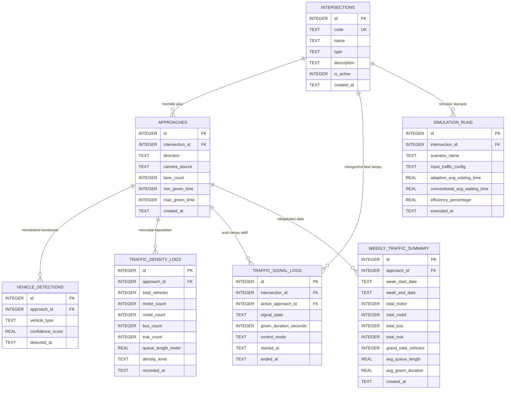

# Dokumentasi Basis Data VROOO (SQLite)
**PBL TRPL Semester 5 - Politeknik Negeri Batam**  
**Judul:** *Pengembangan Autonomous Adaptive Traffic Signal System Berbasis Computer Vision untuk Optimalisasi Pengaturan Lalu Lintas Secara Real-Time*

---

## 1. Arsitektur Data & Alur Sistem

Sistem VROOO bekerja dengan paradigma **Observe - Analyze - Decide - Act**:
1. **Observe (Computer Vision):** Kamera CCTV/webcam menangkap citra persimpangan secara berkala. Kendaraan yang terdeteksi dicatat dalam tabel `vehicle_detections`.
2. **Analyze (Kepadatan Lalu Lintas):** Sistem menghitung jumlah kendaraan per jenis (`MOTOR`, `MOBIL`, `BUS`, `TRUK`), estimasi antrean, dan level kepadatan, lalu menyimpannya dalam tabel `traffic_density_logs`.
3. **Decide (Adaptive Decision Engine):** Algoritma adaptif membandingkan kepadatan tiap jalur/arah mata angin dan menentukan jalur prioritas beserta alokasi waktu hijau (dengan batasan safety `min_green_time` dan `max_green_time`).
4. **Act (Signal Controller):** Perintah dikirim ke modul lampu LED prototype / Raspberry Pi GPIO dan dicatat di `traffic_signal_logs`.
5. **Simulate (Playground):** Skenario pengujian perbandingan adaptif vs konvensional dicatat di `simulation_runs`.
6. **Agregasi Mingguan (OLAP / BI):** Setiap minggu data log mentah diakumulasikan ke `weekly_traffic_summary` dan log mentah dibersihkan untuk efisiensi penyimpanan perangkat embedded.

---

## 2. Diagram Hubungan Entitas (ERD)

---

## 3. Penjelasan Detail Setiap Tabel

### 3.1. Tabel `intersections` (Data Master Simpang)
Menyimpan konfigurasi persimpangan jalan yang menjadi objek pantauan atau prototipe.

| Kolom | Tipe Data | Constraint | Keterangan |
| :--- | :--- | :--- | :--- |
| `id` | INTEGER | PRIMARY KEY AUTOINCREMENT | ID unik persimpangan. |
| `code` | TEXT | UNIQUE, NOT NULL | Kode simpang, misal `'SIMPANG-01'`. |
| `name` | TEXT | NOT NULL | Nama lokasi persimpangan (misal `'Simpang Polibatam'`). |
| `type` | TEXT | NOT NULL, CHECK(`3_WAY`, `4_WAY`, `5_WAY`) | Bentuk persimpangan (Simpang 3, Simpang 4, Simpang 5). |
| `description` | TEXT | NULLABLE | Catatan tambahan mengenai fisik persimpangan. |
| `is_active` | INTEGER | DEFAULT 1 | Status operasional simpang (1 = aktif, 0 = nonaktif). |
| `created_at` | TEXT | DEFAULT CURRENT_TIMESTAMP | Waktu pertama kali simpang didaftarkan ke sistem. |

---

### 3.2. Tabel `approaches` (Data Master Jalur / Arah Mata Angin)
Menyimpan jalur masuk kendaraan menuju persimpangan berdasarkan arah mata angin.

| Kolom | Tipe Data | Constraint | Keterangan |
| :--- | :--- | :--- | :--- |
| `id` | INTEGER | PRIMARY KEY AUTOINCREMENT | ID unik jalur. |
| `intersection_id` | INTEGER | FOREIGN KEY (`intersections.id`) | Mengacu pada simpang tempat jalur ini berada. |
| `direction` | TEXT | CHECK(`UTARA`, `TIMUR`, `SELATAN`, `BARAT`, `BARAT_LAUT`, `TIMUR_LAUT`) | Arah mata angin datangnya arus lalu lintas. |
| `camera_source` | TEXT | NULLABLE | Sumber input video (misal index kamera `'0'`, `'1'`, atau URL RTSP CCTV). |
| `lane_count` | INTEGER | DEFAULT 1 | Jumlah lajur jalan pada arah tersebut. |
| `min_green_time` | INTEGER | DEFAULT 10 | Batas minimal durasi lampu hijau (detik) untuk aspek keselamatan jalan. |
| `max_green_time` | INTEGER | DEFAULT 60 | Batas maksimal durasi lampu hijau adaptif (detik). |
| `created_at` | TEXT | DEFAULT CURRENT_TIMESTAMP | Waktu jalur didaftarkan. |

*Catatan Constraint:* Ada aturan `UNIQUE(intersection_id, direction)` agar satu simpang tidak memiliki arah mata angin ganda yang sama.

---

### 3.3. Tabel `vehicle_detections` (Log Mentah Computer Vision)
Menyimpan setiap objek kendaraan yang berhasil dideteksi oleh model Computer Vision (YOLOv8/SSD/OpenCV) secara *frame-by-frame*.

| Kolom | Tipe Data | Constraint | Keterangan |
| :--- | :--- | :--- | :--- |
| `id` | INTEGER | PRIMARY KEY AUTOINCREMENT | ID unik rekaman deteksi. |
| `approach_id` | INTEGER | FOREIGN KEY (`approaches.id`) | Jalur/arah tempat kendaraan melintas. |
| `vehicle_type` | TEXT | NOT NULL, CHECK(`MOTOR`, `MOBIL`, `BUS`, `TRUK`) | Klasifikasi jenis kendaraan hasil deteksi AI. |
| `confidence_score`| REAL | NULLABLE (0.0 - 1.0) | Tingkat keyakinan deteksi model AI (misal `0.94`). |
| `detected_at` | TEXT | DEFAULT CURRENT_TIMESTAMP | Waktu persis saat kendaraan terdeteksi. |

---

### 3.4. Tabel `traffic_density_logs` (Log Kepadatan Lalu Lintas)
Menyimpan hasil perhitungan agregat kondisi antrean kendaraan per interval waktu (misal tiap 5-15 detik) yang digunakan oleh mesin keputusan adaptif.

| Kolom | Tipe Data | Constraint | Keterangan |
| :--- | :--- | :--- | :--- |
| `id` | INTEGER | PRIMARY KEY AUTOINCREMENT | ID unik catatan kepadatan. |
| `approach_id` | INTEGER | FOREIGN KEY (`approaches.id`) | Jalur pengamatan. |
| `total_vehicles` | INTEGER | DEFAULT 0 | Total seluruh kendaraan yang ada di jalur pengamatan. |
| `motor_count` | INTEGER | DEFAULT 0 | Jumlah sepeda motor. |
| `mobil_count` | INTEGER | DEFAULT 0 | Jumlah mobil pribadi. |
| `bus_count` | INTEGER | DEFAULT 0 | Jumlah bus umum / pariwisata. |
| `truk_count` | INTEGER | DEFAULT 0 | Jumlah truk ekspedisi / muatan besar. |
| `queue_length_meter` | REAL | DEFAULT 0.0 | Estimasi panjang antrean kendaraan dalam meter. |
| `density_level` | TEXT | CHECK(`LOW`, `MEDIUM`, `HIGH`, `CONGESTED`) | Status tingkat kemacetan/kepadatan. |
| `recorded_at` | TEXT | DEFAULT CURRENT_TIMESTAMP | Waktu pencatatan kondisi lalu lintas. |

---

### 3.5. Tabel `traffic_signal_logs` (Log Keputusan Sinyal Lampu)
Mencatat riwayat perubahan status lampu lalu lintas yang dieksekusi oleh mikrokontroler/Raspberry Pi 4 ke modul lampu LED.

| Kolom | Tipe Data | Constraint | Keterangan |
| :--- | :--- | :--- | :--- |
| `id` | INTEGER | PRIMARY KEY AUTOINCREMENT | ID unik log sinyal. |
| `intersection_id` | INTEGER | FOREIGN KEY (`intersections.id`) | Persimpangan yang dikendalikan. |
| `active_approach_id`| INTEGER | FOREIGN KEY (`approaches.id`) | Jalur arah mata angin yang sedang mendapatkan fase lampu hijau. |
| `signal_state` | TEXT | CHECK(`GREEN`, `YELLOW`, `RED`) | Warna lampu yang sedang aktif. |
| `green_duration_seconds` | INTEGER | NOT NULL | Alokasi durasi waktu hijau yang diberikan sistem (detik). |
| `control_mode` | TEXT | CHECK(`ADAPTIVE`, `CONVENTIONAL`) | Mode pengaturan yang digunakan (`ADAPTIVE` berbasis AI atau `CONVENTIONAL` timer tetap). |
| `started_at` | TEXT | DEFAULT CURRENT_TIMESTAMP | Waktu lampu hijau mulai menyala. |
| `ended_at` | TEXT | NULLABLE | Waktu fase lampu berakhir. |

---

### 3.6. Tabel `simulation_runs` (Skenario Web Playground)
Khusus mendukung fitur interaktif pada halaman web **Playground VROOO** (sesuai dokumen SRS Gambar 2, 3, dan 4). Pengguna dapat menguji kombinasi jumlah kendaraan dan membandingkan kinerja sistem adaptif vs lampu konvensional.

| Kolom | Tipe Data | Constraint | Keterangan |
| :--- | :--- | :--- | :--- |
| `id` | INTEGER | PRIMARY KEY AUTOINCREMENT | ID unik sesi simulasi. |
| `intersection_id` | INTEGER | FOREIGN KEY (`intersections.id`) | Simpang yang disimulasikan. |
| `scenario_name` | TEXT | NOT NULL | Nama pengujian (misal `'Simulasi Jam Padat Pagi'`). |
| `input_traffic_config` | TEXT (JSON) | NOT NULL | Payload JSON jumlah kendaraan per arah (Utara, Timur, Selatan, Barat). |
| `adaptive_avg_waiting_time` | REAL | NOT NULL | Rata-rata waktu tunggu metode adaptif (detik). |
| `conventional_avg_waiting_time` | REAL | NOT NULL | Rata-rata waktu tunggu metode konvensional (detik). |
| `efficiency_percentage` | REAL | NOT NULL | Persentase penghematan waktu tunggu yang dicapai (%). |
| `executed_at` | TEXT | DEFAULT CURRENT_TIMESTAMP | Waktu simulasi dijalankan. |

---

### 3.7. Tabel `weekly_traffic_summary` (Data Mart / Rekapitulasi Mingguan)
Mendukung capaian mata kuliah **Kecerdasan Bisnis (CPL-7)**. Tabel ini menyimpan agregasi permanen mingguan sebelum data mentah dibersihkan, sehingga ukuran database tetap ramping namun data analitik jangka panjang tetap terjaga.

| Kolom | Tipe Data | Constraint | Keterangan |
| :--- | :--- | :--- | :--- |
| `id` | INTEGER | PRIMARY KEY AUTOINCREMENT | ID unik ringkasan mingguan. |
| `approach_id` | INTEGER | FOREIGN KEY (`approaches.id`) | Jalur yang direkap. |
| `week_start_date` | TEXT (Date) | NOT NULL | Tanggal awal minggu (format: `YYYY-MM-DD`). |
| `week_end_date` | TEXT (Date) | NOT NULL | Tanggal akhir minggu (format: `YYYY-MM-DD`). |
| `total_motor` | INTEGER | DEFAULT 0 | Akumulasi jumlah motor selama 7 hari. |
| `total_mobil` | INTEGER | DEFAULT 0 | Akumulasi jumlah mobil selama 7 hari. |
| `total_bus` | INTEGER | DEFAULT 0 | Akumulasi jumlah bus selama 7 hari. |
| `total_truk` | INTEGER | DEFAULT 0 | Akumulasi jumlah truk selama 7 hari. |
| `grand_total_vehicles`| INTEGER | DEFAULT 0 | Total akumulasi semua kendaraan dalam 1 minggu. |
| `avg_queue_length` | REAL | DEFAULT 0.0 | Rata-rata panjang antrean selama minggu tersebut. |
| `avg_green_duration` | REAL | DEFAULT 0.0 | Rata-rata alokasi waktu hijau yang diberikan sistem. |
| `created_at` | TEXT | DEFAULT CURRENT_TIMESTAMP | Waktu kalkulasi ETL summary dieksekusi. |

---

## 4. Kebijakan Retensi & Otomatisasi Log Mingguan

Untuk mencegah memori kartu SD pada Raspberry Pi 4 penuh akibat ratusan ribu baris log deteksi kamera, sistem menerapkan mekanisme:
1. Setiap minggu (dijadwalkan di crontab Linux atau *Task Scheduler* Windows), script `cleanup_and_summary.py` akan:
   - Menghitung rekapitulasi data dari tabel `traffic_density_logs` dan `traffic_signal_logs` selama 7 hari ke belakang.
   - Melakukan `UPSERT` ke dalam `weekly_traffic_summary`.
   - Menghapus (*delete*) baris log pada `vehicle_detections`, `traffic_density_logs`, dan `traffic_signal_logs` yang lebih lama dari 7 hari.
   - Menjalankan `VACUUM;` untuk mengompres dan menyusun ulang file SQLite di media penyimpanan.
